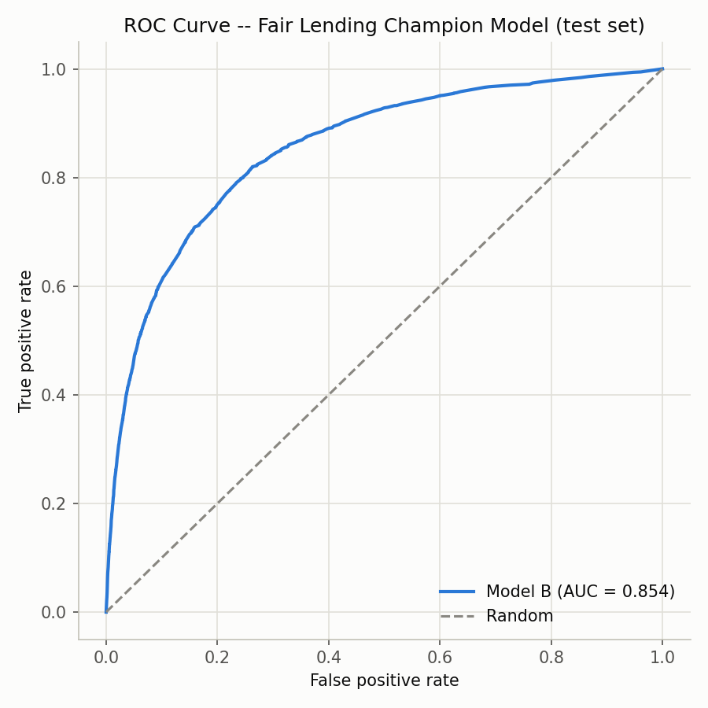
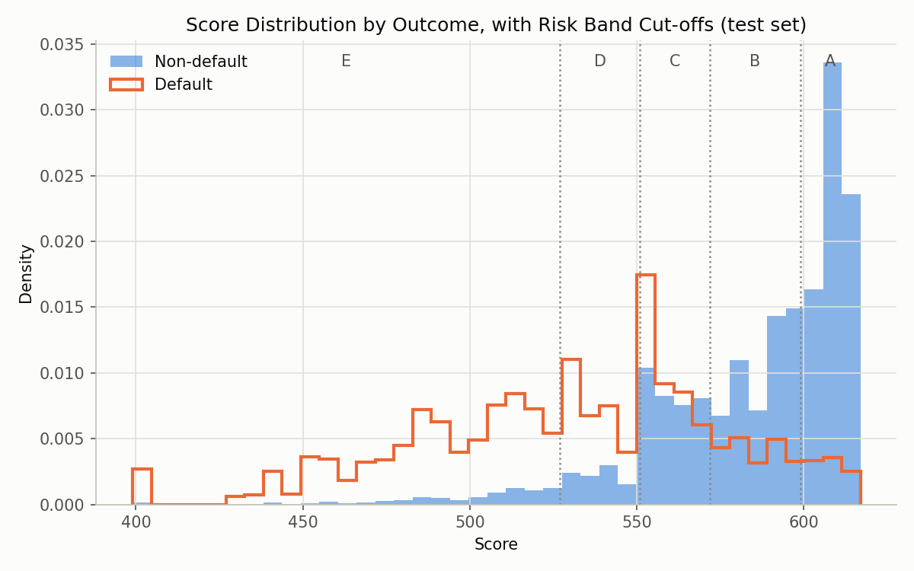
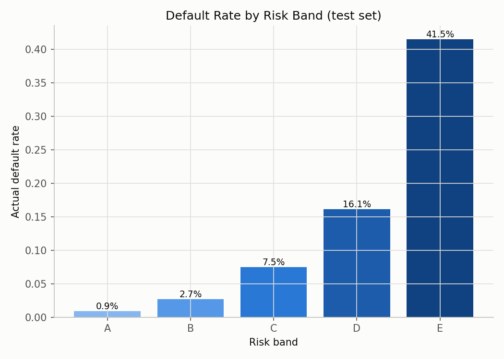
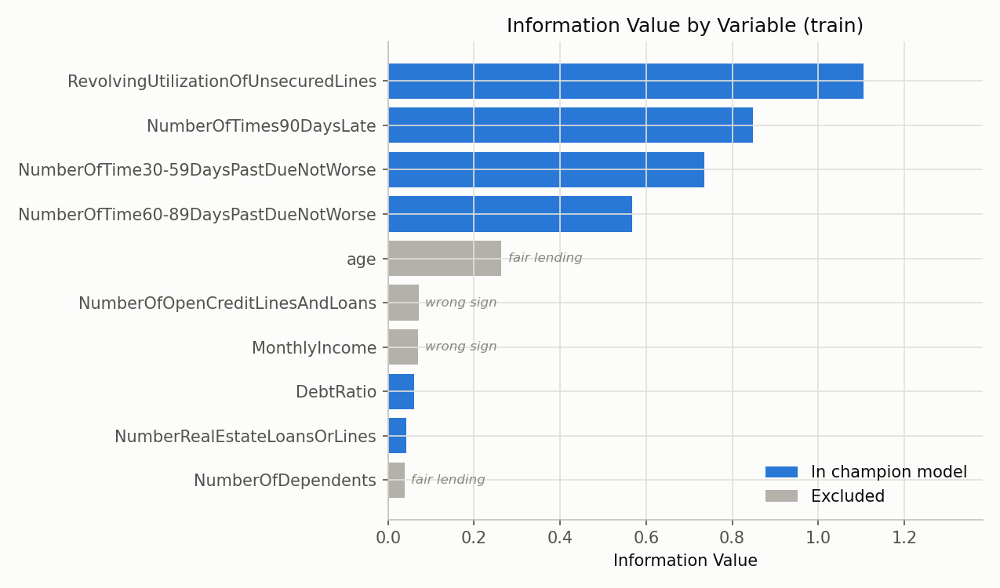
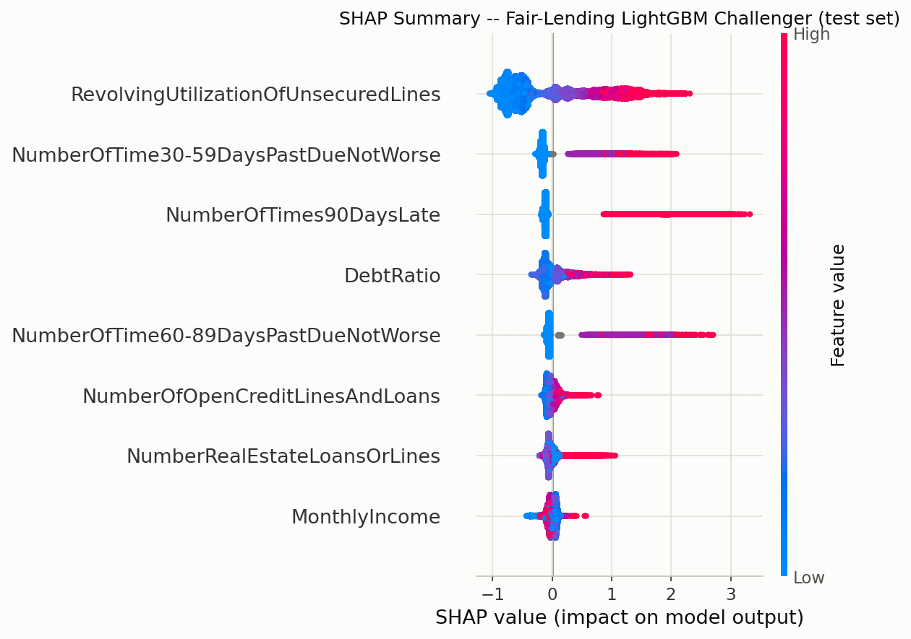
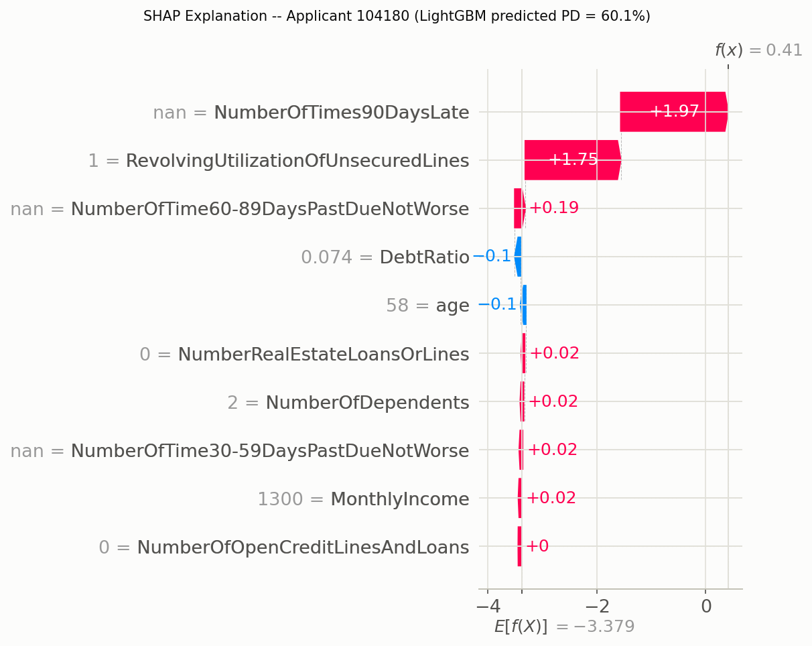

# Credit Risk Scorecard -- Sample Bank

**Author:** Annapurna Zutshi

> "Sample Bank" is a fictional lender. This is a portfolio project built end
> to end on the Kaggle "Give Me Some Credit" dataset -- not a real bank, not
> real applicants, and nothing here is legal, compliance, or credit advice.

## Project Summary

A full retail-credit-risk build, from raw Kaggle data to a working app:
data cleaning and exploration, Weight-of-Evidence binning and Information
Value, a logistic-regression points scorecard (with an explicit fair-lending
variant), model validation (Gini/KS/PSI, calibrated risk bands), a LightGBM
+ SHAP challenger model, a rule-based decision engine layered on top of the
scorecard, and a RAG assistant that drafts credit memos citing the bank's
own policy documents -- all wrapped in a Streamlit app.

The goal was to build each piece the way a bank credit risk team actually
would: fit bins and the model on training data only, validate out-of-sample,
document every policy-driven decision, and treat fair lending as a design
constraint from the start rather than an afterthought.

## Results

### Model comparison (test set, held out from all fitting)

| Model | AUC | Gini | KS |
|---|---|---|---|
| **Scorecard (Model B) -- CHAMPION** -- WoE logistic regression, fair lending | 0.8540 | 0.7081 | 0.5572 |
| **LightGBM (fair lending) -- OFFICIAL CHALLENGER** -- excludes age & dependents | 0.8626 | 0.7252 | 0.5764 |
| LightGBM (all raw features) -- reference only, *not production-usable* | 0.8652 | 0.7304 | 0.5811 |

Excluding age and number of dependents cost the scorecard ~0.7% Gini, and
cost LightGBM an almost identical ~0.7% Gini -- two different model families
landing on the same fair-lending cost is a reassuring sign that figure
reflects genuine information loss, not a quirk of either model.

### Risk bands (test set)

| Band | Decision | Applicants | Share | Actual default rate | Target PD |
|---|---|---|---|---|---|
| A | Approve | 18,268 | 40.8% | 0.94% | < 2% |
| B | Approve | 13,140 | 29.3% | 2.85% | 2-5% |
| C | Approve with conditions | 6,539 | 14.6% | 8.18% | 5-10% |
| D | Refer to underwriter | 3,736 | 8.3% | 16.41% | 10-20% |
| E | Decline | 3,135 | 7.0% | 41.72% | >= 20% |

All five bands' actual default rates fall inside their target range on
held-out data -- the scorecard is calibrated, not just well-ranked.

### Charts

| | |
|---|---|
|  |  |
|  |  |
|  |  |

## Key Decisions Along the Way

- **The `DebtRatio` / missing-income discovery.** During exploration, extreme
  `DebtRatio` values turned out to be almost entirely explained by missing
  `MonthlyIncome` -- 92.7% of rows with `DebtRatio` > 10 had no declared
  income, versus 1.75% of rows with income present. When income is unknown,
  the field holds a raw debt payment amount, not a true ratio. Cleaning sets
  `DebtRatio` to missing wherever income is missing, rather than trusting a
  nonsensical "350x debt-to-income" value.
- **Fair lending exclusion, and its cost.** `age` and `NumberOfDependents`
  are deliberately excluded from the champion scorecard -- age is an
  explicitly protected characteristic under US ECOA, and dependents is a
  known proxy for marital/family status. The measured cost was **~0.7%
  Gini** for the scorecard and the same ~0.7% for the LightGBM challenger --
  a small accuracy cost relative to the fair-lending risk avoided.
- **R5 and the Manual-review cap.** One hard policy rule (R5: missing or
  invalid delinquency data) deliberately caps the decision at *Manual
  review* even when the risk band alone says *Decline*, rather than letting
  the system auto-decline on a known data-quality gap. The trade-off is
  explicit and documented: every R5 case, including genuinely high-risk
  ones, goes to a human review queue instead of an automated outcome.
- **RAG citation audit and the similarity threshold.** The credit-memo
  assistant's citations were audited by hand against the actual policy text
  they were meant to support -- which caught a retrieval bug (an irrelevant
  "Conditions for Band C" section surfacing on an unrelated rule query) and
  a citation-targeting bug (a reason-codes query matching a *less* precise
  policy section than the one that actually describes reason codes). Both
  were fixed: a minimum cosine-similarity threshold (0.16, picked from the
  score distribution across all three example applicants' queries) on the
  retriever, and per-claim targeted retrieval in the memo template instead
  of a broad merged chunk list.

## Example Credit Memos

Two versions of the same applicant (id 104180, Band E, R5 triggered -- the
scorecard caps the outcome at Manual review instead of an automated
Decline), generated two ways:

- [Template memo](reports/example_memos/applicant_104180_template.md) --
  deterministic, no API key required
- [Claude-generated memo](reports/example_memos/applicant_104180_claude.md)
  -- `claude-opus-5-5`, grounded in the retrieved policy text with inline
  citations

## How to Run It

```bash
# 1. Clone the repo
git clone https://github.com/azutshi1305-coder/Credit-Risk-Scorecard.git
cd Credit-Risk-Scorecard

# 2. Install dependencies
pip install -r requirements.txt

# 3. Get the data (not included in the repo -- see Data/ below)
#    Download cs-training.csv from the Kaggle "Give Me Some Credit" competition
#    and place it at Data/cs-training.csv, then:
python clean_data.py

# 4. (Optional) enable the live Claude memo assistant
cp .env.example .env
# then edit .env and set ANTHROPIC_API_KEY=sk-ant-...
# without a key, the app still works -- it falls back to a template memo

# 5. Launch the app
streamlit run app.py
```

The app's first load trains the LightGBM challengers (a few seconds) and is
cached after that within the session.

### Project structure

```
clean_data.py          Step 2: cleaning rules
split_data.py           Stratified train/test split, reused everywhere
woe_binning.py           Step 3: WoE/IV diagnostics
scorecard_model.py        Step 4: WoE transformer + logistic regression (champion + fair-lending)
points_scorecard.py        Step 5: points conversion, scoring, reason codes
validate_and_report.py      Step 6: AUC/Gini/KS/PSI, risk bands, charts
challenger_model.py         Step 7: LightGBM challengers + SHAP
policies/                   Step 8a: fictional Sample Bank policy documents
decision_engine.py          Step 8a: hard rules + band -> final decision
policy_retriever.py         Step 8b: TF-IDF chunking and retrieval over policies/
rag_memo.py                 Step 8b: credit memo generation (Claude or template fallback)
app.py                      Step 9: Streamlit app
reports/figures/            Generated charts
reports/example_memos/      Saved example memos (template + Claude)
```

## Limitations

- **Random, not out-of-time, train/test split.** The 70/30 split is random,
  which tests generalization to unseen applicants but not stability over
  time. A production validation would hold out a later vintage (e.g. train
  on one year, test on the next) to check the model still performs as the
  applicant population and economic conditions drift -- this project doesn't
  have a date field to do that.
- **Policies are illustrative, not real.** "Sample Bank" and its three
  policy documents were written for this project to give the decision
  engine and RAG assistant something concrete to work against. They are
  plausible summaries of real regulatory concepts (ECOA/Reg B, RBI Fair
  Practices Code) but are not legal advice and omit substantial real-world
  detail and jurisdictional nuance.
- **The retrieval similarity threshold was tuned on very few examples.** The
  0.16 cosine-similarity cutoff was picked by inspecting scores across just
  3 example applicants' worth of queries (9 queries, 33 scores). It cleanly
  separated genuine matches from noise in that sample, but a larger, more
  varied set of applicants and a bigger policy corpus could easily surface
  cases that threshold doesn't handle well.
